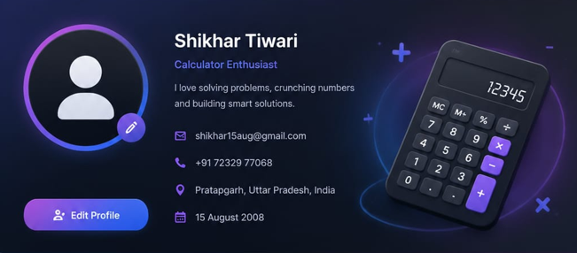

# 🧮 Calculator Project

A simple, responsive, and user-friendly **Calculator Web Application** built using **HTML, CSS, and JavaScript**.

This project demonstrates the use of HTML for structure, CSS for styling and responsive design, and JavaScript for implementing calculator functionality and user interactions.

## 🚀 Live Demo

🔗 **Live Demo:**  [View Calculator Live](https://calculator-project-eight-chi.vercel.app)

## 📸 Preview



## ✨ Features

* ➕ Addition
* ➖ Subtraction
* ✖️ Multiplication
* ➗ Division
* 🔢 Decimal number support
* 🧹 Clear / Reset functionality
* ⌫ Delete / Backspace functionality
* 📱 Responsive design
* 🎨 Clean and modern user interface
* ⚡ Fast and lightweight
* 🖱️ Interactive buttons with JavaScript

## 🛠️ Technologies Used

* **HTML5** – Structure of the calculator
* **CSS3** – Styling, layout, animations and responsive design
* **JavaScript** – Calculator logic and user interactions

## 📂 Project Structure

```text
Calculator-Project/
│
├── index.html
├── style.css
├── script.js
└── README.md
```

## ⚙️ How to Run

1. Clone this repository:

```bash
git clone https://github.com/shikhartiwari1508/Calculator-Project.git
```

2. Open the project folder.

3. Open `index.html` in your web browser.

That's it! 🎉

## 🎯 Purpose of the Project

The main purpose of this project is to practice and demonstrate fundamental **Frontend Web Development** concepts, including:

* HTML structure
* CSS styling
* Responsive web design
* JavaScript DOM manipulation
* Event handling
* Basic programming logic

## 📚 What I Learned

While building this project, I practiced:

* Creating webpage layouts using HTML
* Designing interfaces using CSS
* Handling button clicks using JavaScript
* Performing mathematical operations programmatically
* Connecting HTML, CSS and JavaScript
* Making a web application responsive

## 🔮 Future Improvements

Some features that can be added in the future:

* 🌙 Dark/Light mode
* ⌨️ Keyboard support
* 📜 Calculation history
* 🔊 Button sound effects
* 💾 Memory functions
* 🎨 Multiple calculator themes

## 👨‍💻 Author

**Mr. Shikhar Tiwari**

🎓 Integrated BCA & MCA (Data Science)

🔗 GitHub: [@shikhartiwari1508](https://github.com/shikhartiwari1508)

---

⭐ If you like this project, consider giving it a **star**!
